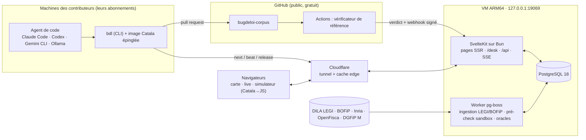

# BugDeLoi — Plan technique (v0, 25/11/2026)

> **Document historique.** C'est le plan d'origine, conservé tel quel pour mémoire. Le projet a évolué
> depuis (guichet à liste unique, suivi des tâches par fiche et tableau, identité « Hémicycle »).
> L'état réel est dans [`STATUS.md`](STATUS.md), les règles dans [`AGENTS.md`](../AGENTS.md).

> Statut : **J0 en cours** (démarré le 25/11/2026). Ce document fixe l'objectif final, les choix
> techniques, les marqueurs de preuve et l'ordre de construction. Les règles opérationnelles pour les
> agents sont dans [`AGENTS.md`](../AGENTS.md) (qui fait foi pour les niveaux de preuve et les
> certificats). L'état d'avancement vivant est dans [`docs/STATUS.md`](STATUS.md).
>
> Nom public : **BugDeLoi** (domaine `bugdeloi.theonaciri.fr`), dépôt sur le GitHub personnel
> `theonaciri` (voir §14).

---

## 0. En une page

**But final.** Faire du droit calculable français un bien commun _vérifiable_ : chaque article
formalisé en Catala, relié à son texte officiel (LEGI/DILA), chaque affirmation accompagnée d'un
**certificat rejouable** par n'importe qui, et une interface publique qui montre où en est la
retranscription et invite à contribuer avec son abonnement LLM inutilisé ou à sponsoriser le projet.

**Idée directrice : on ne fait jamais confiance à un LLM, on fait confiance à ce qu'un tiers peut rejouer.**
Les LLM produisent des _candidats_ (traductions, tests, contre-exemples, relectures). Le compilateur
Catala, des oracles indépendants (Inria, DGFiP, BOFiP, OpenFisca) et des humains signataires
transforment ces candidats en **niveaux de preuve** explicites.

**Architecture : l'origine coordonne, les bords calculent.**

| Calcul                                                         | Où il tourne                                                                                    | Coût pour le projet |
| -------------------------------------------------------------- | ----------------------------------------------------------------------------------------------- | ------------------- |
| Tokens LLM (traduction, red-team…)                             | Machines des contributeurs, via **leurs** abonnements (Claude Code, Codex, Gemini CLI, Ollama…) | 0 €                 |
| Pré-vérification (typecheck, tests rapides)                    | Chez le contributeur (image Docker Catala), puis re-contrôle rapide sur l'origine               | ~0 €                |
| Vérification **de référence** (tests, différentiel, mutations) | **GitHub Actions** sur le dépôt public du corpus (gratuit pour les dépôts publics)              | 0 €                 |
| Simulations citoyennes (cas types)                             | **Navigateur** (Catala compilé vers JS)                                                         | 0 €                 |
| Coordination, base, temps réel, pages                          | VM ARM64 (4 cœurs, 24 Go) → Cloudflare Tunnel → `127.0.0.1:19069`                               | déjà payé           |

**Stack retenue (gratuite, un seul langage applicatif) :** TypeScript strict · **Bun** · **SvelteKit 3 / Svelte 5**
(pages SSR + API + SSE dans un seul process) · **PostgreSQL 18** (déjà installé sur l'hôte) + Drizzle ·
**pg-boss** (files de tâches dans Postgres, pas de Redis) · **Podman rootless** (sandbox Catala) ·
**GitHub** (corpus, CI, identité des contributeurs) · **Cloudflare** (tunnel, cache edge, analytics sans cookie).

**Premier cycle (« rejouer la science ») avant toute découverte :** le système doit d'abord retrouver
ce que les chercheurs ont déjà établi — rejouer les suites de tests Inria, re-formaliser _à l'aveugle_
les allocations familiales et se noter sur les tests Inria, redécouvrir les ambiguïtés que les auteurs
Inria/DGFiP ont annotées, retrouver le taux marginal implicite de la décote. Ce n'est qu'une fois ces
scores publiés que les « failles » nouvelles ont une crédibilité.

---

## 1. Ce que j'ai compris, et ce qu'il faut corriger dans le livre blanc

### 1.1 L'objectif

Combler l'espace vide entre Légifrance (texte brut), LexImpact (curseurs paramétriques) et Catala
(outil de recherche) : une plateforme collaborative ouverte qui (1) formalise le droit calculable,
(2) détecte des anomalies avec preuves, (3) permet de simuler et comparer des réformes, (4) rend tout
cela lisible pour citoyens, journalistes, parlementaires, juristes.

### 1.2 Ce que l'étude a vérifié (état au 25/11/2026)

- **Catala 1.3.2** (16/11/2026), Apache-2.0. Backends : OCaml, Python, C, Java, JS. Outil `clerk`
  (`clerk build`, `clerk test`, `clerk run --scope=…`, `clerk ci`, traces JSON depuis 1.3.0). Tests =
  scopes sans entrée annotés `#[test]` avec `assertion`. Installation via opam ; **pas de binaire
  ARM64 publié trouvé** → construire notre propre image multi-arch. Un _playground_ navigateur existe
  (« programmes simples uniquement »). Le README prévient : « compiler is yet unstable ».
- **`CatalaLang/catala-examples`** (Apache-2.0) contient déjà : `allocations_familiales`,
  `aides_logement` (le plus gros), `impot_revenu` (**copyright DGFiP 2023-2024, licence CeCILL**,
  revenus catégoriels → revenu brut global, parts), `prestations_familiales`, `smic`,
  `droit_successions`, `asp`, etc. On y compte **507 identifiants `LEGIARTI` distincts**, **46
  références BOFiP distinctes** et **21 annotations « TODO juridique »** (questions ouvertes notées
  par les auteurs). C'est notre vérité terrain et notre banc d'étalonnage.
- **DILA LEGI** : archive globale `Freemium_legi_global_*.tar.gz` (~1,2 Go) + incréments quasi
  quotidiens `LEGI_*.tar.gz` sur `https://echanges.dila.gouv.fr/OPENDATA/LEGI/`, Licence Ouverte.
  Pas besoin de l'API PISTE (OAuth, quotas) pour le PoC.
- **BOFiP** en open data (data.economie.gouv.fr, XML, Licence Ouverte 2.0) : contient des
  **exemples chiffrés** — d'excellents oracles indépendants.
- **DGFiP** publie le code M du calcul de l'IR (Adullact, CeCILL) et le compilateur **Mlang** (GPL-3).
  C'est le calcul de production : l'oracle le plus fort pour l'IR (à intégrer en second temps).
- **OpenFisca-France** : implémentation indépendante, tests YAML → oracle différentiel.
- **Tricoteuses** : données Assemblée/Sénat (dont amendements) et « La loi sous git » (CC BY-SA).
- **pequalnp.com** : voir §2.

### 1.3 Corrections nécessaires (sinon on perd la confiance des juristes au premier article)

1. **Catala ne prouve pas qu'une traduction est fidèle à la loi.** Il garantit le typage, l'absence
   de conflit entre exceptions / de cas non couvert _sur les entrées testées_, et une compilation
   fidèle vers les backends. Le support de preuve Z3 est un paquet séparé (`catala-proof`), à
   évaluer avant de lui accorder un statut. Le site ne doit jamais afficher « prouvé » au sens absolu :
   il affiche un **niveau de preuve** défini mécaniquement (§8, `AGENTS.md`).
2. **Lexifina (138 erreurs dans le Title 26)** : seules des sources secondaires ont été trouvées.
   À citer comme inspiration, pas comme fait établi. Les _catégories_ d'erreurs (renvois obsolètes,
   coquilles de citation, numéros dupliqués, parenthèses non fermées) sont en revanche détectables
   **sans LLM** sur LEGI — c'est notre « première lumière » (§9).
3. **Une référence à un article abrogé n'est pas forcément un bug** (dispositions transitoires,
   « dans sa rédaction antérieure »). Un détecteur produit des _candidats_, la qualification est une
   étape distincte et visible.
4. **Microsimulation par décile = données restreintes** (ERFS, POTE via CASD). Le PoC travaille sur
   des **cas types** et éventuellement des populations synthétiques **étiquetées comme telles**. Pas
   de chiffrage budgétaire national tant qu'on n'a pas de données légitimes.
5. **Projection N+1 → N+20 = modèle économique, pas preuve.** Hypothèses explicites, réglables,
   affichées à côté de chaque courbe. Jamais coloré comme une preuve.
6. **« Génération automatique du module OpenFisca »** : Catala produit du Python scalaire, OpenFisca
   est vectorisé. C'est un chantier de recherche (phase 3+), pas un livrable du PoC.
7. **Ne pas utiliser le DSFR / Marianne** : réservés aux sites de l'État. Design system propre, et
   mention claire « site citoyen indépendant, pas un service officiel, pas un conseil juridique ».

---

## 2. Leçons de pequalnp.com (ce qu'on copie, ce qu'on adapte)

Ce que fait pequalnp.com (lu sur `/`, `/live`, `/how`, `/about`, `/join.txt`, `/sponsors`) :

- **`/join.txt`** : une page texte d'instructions _pour l'agent de code_ du contributeur (Claude Code,
  Cursor, Codex, Gemini CLI…). L'agent tourne chez son propriétaire, sur son abonnement ; le site
  **ne demande jamais de token**.
- **Un « desk » à baux** : `GET /desk/next?handle=` renvoie une étape + un bail ; `POST /desk/beat`
  toutes les 10 min (bail de 20 min, 6 h max) ; `POST /desk/release?reason=` avec des raisons
  normalisées (`submitted`, `statement_seems_false`, `missing_lemma`, `out_of_time`…). Un 2ᵉ agent
  n'est ajouté sur une étape qu'après 5 min sans résultat, un 3ᵉ après 10.
- **Soumission = 1 étape, 1 branche, 1 commit, 1 fichier, 1 PR** sur le dépôt public. Le contrôle
  CI (6–20 min) répond ACCEPTED / REJECTED / FAULT en commentaire. Le crédit va au compte GitHub.
- **Règles de format vérifiées par un programme avant compilation** (pas de `sorry`, pas d'axiome,
  pas de chaînes, liste blanche d'options…) : l'anti-triche est mécanique.
- **Réductions** : un agent bloqué peut soumettre « l'étape découle de 2 à 4 énoncés plus petits » ;
  crédit seulement quand tous sont prouvés.
- **Rôles** : penseurs (raisonnent sur papier) → bâtisseurs (écrivent le Lean) ; **red team** dont la
  réfutation « est créditée comme une preuve » ; un orchestrateur _qui n'a pas écrit l'énoncé_ vérifie
  qu'il veut bien dire ce qu'il dit en français.
- **UX** : bandeau en direct, compteurs (« vérifiés / réfutés / abandonnés »), histogramme vérifié ↑
  réfuté ↓, « le registre » + « le cimetière », classement heure/total, flotte en direct, et la
  mention « **un compte, pas une probabilité** ». Sponsors : logo à palier, listing dès 5 $, paiement
  pas encore ouvert.

**Adaptation au droit.** En mathématiques, Lean juge tout : l'énoncé est fixé, la preuve est vraie ou
fausse. En droit, **la fidélité au texte n'est pas décidable par une machine**. Donc :

- l'« énoncé » devient une **interface** (signature d'un scope Catala : entrées, sorties, types) +
  une **batterie d'oracles** issus de sources indépendantes ;
- « vérifié » devient une **échelle de niveaux de preuve** cumulatifs, chacun mécaniquement
  contrôlable (§8) ;
- on garde intégralement : join.txt, desk à baux, PR à fichier unique, CI publique comme juge,
  liste blanche de constructions, red team à égalité de crédit, réductions, cimetière public.

---

## 3. Où tourne le calcul (la réponse à « autant de calculs concurrentiels »)

Le goulot n'est pas le serveur web : c'est (a) les tokens LLM et (b) la compilation/les tests Catala.
Les deux sont poussés vers les bords.

1. **LLM** : jamais sur l'origine. Les contributeurs utilisent leurs propres outils. La plateforme ne
   stocke **aucune clé** et ne relaie **aucun abonnement** (le partage d'abonnement violerait les CGU
   des fournisseurs ; ici chacun utilise le sien sur sa machine).
2. **Pré-check** : le contributeur lance `bdl check` (image Catala épinglée) avant de soumettre.
   L'origine refait un contrôle rapide (typecheck + tests de la tâche) dans un pool de **2–3 slots
   sandboxés** (4 cœurs partagés avec d'autres services) → ordre de grandeur : quelques milliers de
   contrôles par heure, largement suffisant.
3. **Vérification de référence** : GitHub Actions sur le dépôt corpus (runners gratuits pour les
   dépôts publics, x64 et ARM64, ~20 jobs concurrents). C'est elle qui fait foi : n'importe qui peut
   relire le log et rejouer.
4. **Simulation citoyenne** : le code Catala des chantiers publiés est compilé en JS et servi
   statiquement ; le navigateur calcule. Coût serveur nul, montée en charge infinie derrière Cloudflare.
5. **Temps réel** : un seul flux SSE par visiteur, alimenté par `LISTEN/NOTIFY` Postgres et
   **coalescé côté serveur** (≤ 1 instantané/s). Les instantanés JSON publics sont mis en cache à
   l'edge (`Cache-Control: public, s-maxage=5`) : 10 000 visiteurs ≈ quelques requêtes/s sur l'origine.
6. **Pages** : SSR + cache edge ; les pages d'articles (des dizaines de milliers) sont rendues une fois
   et invalidées à l'ingestion.

Ordres de grandeur attendus sur l'origine : desk < 10 req/s même avec 1 000 agents (un `beat` / 10 min),
événements < 50 écritures/s. Postgres et un process Bun tiennent cela sans effort.

---

## 4. Stack technique

| Couche              | Choix                                                                                                                                              | Pourquoi                                                                                                                                                                    | Écarté                                                                                  |
| ------------------- | -------------------------------------------------------------------------------------------------------------------------------------------------- | --------------------------------------------------------------------------------------------------------------------------------------------------------------------------- | --------------------------------------------------------------------------------------- |
| Langage             | **TypeScript strict** partout (web, API, worker, CLI)                                                                                              | Un seul langage à maintenir ; c'est le langage le mieux maîtrisé par les agents de code                                                                                     | Mix Go/Python/TS                                                                        |
| Runtime + outillage | **Bun 1.4** (runtime, gestionnaire de paquets, test runner)                                                                                        | Déjà installé, rapide, un outil au lieu de quatre. Repli Node 22 si incompatibilité                                                                                         | pnpm+vitest+tsx                                                                         |
| Web                 | **SvelteKit 3 + Svelte 5**                                                                                                                         | SSR (référencement des pages d'articles), routes API, SSE et formulaires dans **un seul process** ; bundle léger, très performant pour des tableaux de bord                 | Next.js (lourd, orienté Vercel), Astro (scinde l'app interactive), Phoenix (2ᵉ langage) |
| Style               | **Tailwind CSS 4** + design system maison (tokens CSS, clair/sombre)                                                                               | Rapide, sans dépendance UI lourde. Pas de DSFR (réservé à l'État)                                                                                                           | DSFR                                                                                    |
| Visualisation       | **d3-hierarchy** (treemap/icicle de la carte), **Sigma.js + graphology** (graphe WebGL de `/live`), **Observable Plot** (histogrammes)             | Milliers de nœuds fluides ; bibliothèques stables et gratuites                                                                                                              | Cytoscape (lent >5k nœuds)                                                              |
| Base                | **PostgreSQL 18** (cluster déjà présent, base dédiée `bugdeloi`) + **Drizzle ORM**                                                                 | JSONB, `ltree` (hiérarchie code › livre › titre › article), FTS `french` + `unaccent` + `pg_trgm`, `LISTEN/NOTIFY`, `SKIP LOCKED` pour les baux, partitionnement du journal | SQLite (un seul écrivain, pas de NOTIFY), Supabase/Firebase (dépendance)                |
| Tâches              | **pg-boss**                                                                                                                                        | File de tâches dans Postgres : pas de Redis à opérer                                                                                                                        | Redis/BullMQ, Kafka                                                                     |
| Sandbox             | **Podman rootless** (installé) : `--network=none --read-only --memory --cpus --pids-limit`, tmpfs, délai max                                       | Isolation suffisante pour un compilateur ; zéro service en plus                                                                                                             | Firecracker (surdimensionné)                                                            |
| Catala              | Image OCI **multi-arch** construite par nous depuis opam `catala.1.3.2`, épinglée par **digest**                                                   | Pas de binaire ARM64 officiel trouvé ; reproductibilité exacte                                                                                                              | `:latest`                                                                               |
| Oracles             | Worker Python isolé (**uv**) : `openfisca-france` épinglé ; plus tard **Mlang** + code M DGFiP                                                     | Implémentations indépendantes                                                                                                                                               | —                                                                                       |
| Corpus              | Dépôt GitHub public `bugdeloi-corpus` + **GitHub Actions** + **GitHub App** (commentaires de verdict, webhooks signés)                             | Historique, revue, CI gratuite, identité des contributeurs sans gérer de comptes                                                                                            | Forge auto-hébergée (maintenance)                                                       |
| Auth humains        | Phase 2 : **Better Auth** (OAuth GitHub + lien magique e-mail)                                                                                     | Auto-hébergé, gratuit                                                                                                                                                       | Auth0/Clerk                                                                             |
| Hébergement         | 2 unités **systemd** (web, worker) ; `cloudflared` (déjà actif) + règle d'ingress `bugdeloi.theonaciri.fr → http://127.0.0.1:19069`                | Simple, pas d'orchestrateur                                                                                                                                                 | Kubernetes, Docker Compose pour l'app                                                   |
| Sauvegardes         | `pg_dump` nocturne chiffré → **Cloudflare R2** (10 Go gratuits) ; corpus déjà dans Git                                                             | Restauration testée chaque mois                                                                                                                                             | —                                                                                       |
| Observabilité       | journald + page publique `/status` + **Cloudflare Web Analytics** (sans cookie → pas de bandeau)                                                   | Transparence, RGPD minimal                                                                                                                                                  | Google Analytics                                                                        |
| Dons                | **GitHub Sponsors** (0 % de frais), **Liberapay** (association française, 0 % de frais de plateforme), **Open Collective** (comptabilité publique) | Gratuit et transparent ; voir §12                                                                                                                                           | Stripe maison au début                                                                  |

**Contraintes de l'hôte constatées** : aarch64, 4 cœurs, 23 Go RAM (≈14 Go disponibles, partagés),
83 Go disque libres ; Postgres 18 déjà actif ; `cloudflared` et `nginx` déjà actifs ; port 19069 libre.
Budget mémoire proposé : web ≤ 512 Mo, worker ≤ 1 Go, sandbox 3 × 1,5 Go.

---

## 5. Architecture

**Deux dépôts :**

- `bugdeloi` (ce dépôt) — la plateforme : `apps/web`, `apps/worker`, `packages/core` (types, échelle de
  preuve, schémas), `packages/ingest` (parseur LEGI/BOFiP), `packages/runner` (sandbox Catala),
  `packages/cli` (`bdl`), `docs/`.
- `bugdeloi-corpus` — le droit formalisé : `cgi/…/*.catala_fr`, `interfaces/`, `oracles/` (cas de test
  **en données**, YAML), `findings/` (certificats), `replications/`, `ledger/` (dépenses), `AGENTS.md`,
  `.github/workflows/check.yml`. Séparer les dépôts sépare les licences, la CI et le bruit des PR d'agents.

**Vérité :** Git (corpus) est la source de vérité de ce qui est _établi_ ; Postgres est l'établi de
travail (baux, candidats, événements, votes) et un index dérivé, reconstructible depuis Git + DILA.

---

## 6. Modèle de données (noyau)

| Table            | Rôle                                                                     | Champs clés                                                                                                                                                                                                |
| ---------------- | ------------------------------------------------------------------------ | ---------------------------------------------------------------------------------------------------------------------------------------------------------------------------------------------------------- |
| `legal_unit`     | Article/alinéa officiel, versionné                                       | `legiarti`, `path ltree` (code.livre.titre…), `version_start/end`, `etat` (VIGUEUR/ABROGE…), `text`, `text_sha256`, `links jsonb`                                                                          |
| `node`           | Unité de formalisation (un ou plusieurs articles derrière une interface) | `interface_id`, `chantier`, `level` (N0–N5, ★), `flags` (contesté…), `pinned_catala`                                                                                                                       |
| `interface`      | « L'énoncé » : signature du scope Catala, figée et versionnée            | `name@vN`, `inputs`, `outputs`, `legal_units[]`, `frozen_at`                                                                                                                                               |
| `artifact`       | Toute contribution typée, **jamais modifiée** (append-only)              | `kind` (translation, oracle_case, counterexample, backtranslation, review, reduction, objection, finding), `author_handle`, `role`, `family`, `model_declared`, `tokens_declared`, `git_sha`, `supersedes` |
| `evidence`       | Résultat d'un contrôle mécanique                                         | `node`, `check` (anchor, compile, oracles, differential, mutation, backtranslation, human), `result`, `certificate jsonb`, `checker_version`, `ci_run_url`                                                 |
| `finding`        | Anomalie publiée ou candidate                                            | `type` (§8.3), `status` (candidate → reproduced → qualified → published / rejected), `certificate`, `replay_cmd`                                                                                           |
| `task` / `lease` | Distribution du travail                                                  | `role`, `node`, `context_pack`, `blind_to[]`, `lease_expires`, `attempts`                                                                                                                                  |
| `event`          | Journal public append-only (partitionné par mois)                        | `ts`, `type`, `actor`, `payload` → alimente SSE, histogrammes, `/feed.atom`                                                                                                                                |
| `ledger_entry`   | Transparence financière                                                  | `date`, `kind` (don, dépense, compute déclaré), `amount`, `proof_url`                                                                                                                                      |

---

## 7. Faire collaborer plusieurs LLM sans qu'ils se remplacent

Le piège : mettre trois modèles sur la même tâche et garder « le meilleur ». On gaspille deux tiers
du travail et on hérite des erreurs corrélées. Le principe retenu : **chaque modèle produit un
artefact d'un type différent qui sert d'entrée ou de contrôle à un autre**, et c'est le noyau
(compilateur + oracles + rejeu) qui tranche, jamais un vote de modèles.

### 7.1 Rôles et barrières d'information (N-version programming)

| Rôle                           | Voit                                | Ne voit pas                 | Produit                                                     |
| ------------------------------ | ----------------------------------- | --------------------------- | ----------------------------------------------------------- |
| **Analyste** (« penseur »)     | Texte LEGI, renvois, doctrine       | —                           | Interface proposée, notes d'ambiguïté, découpage, glossaire |
| **Traducteur** (« bâtisseur ») | Texte, interface, oracles existants | Autres traductions en cours | Fichier `.catala_fr` lettré                                 |
| **Oracle**                     | Texte, BOFiP, brochures, OpenFisca  | **Le code Catala du nœud**  | Cas de test _en données_ avec source ou dérivation écrite   |
| **Red team**                   | Tout                                | —                           | Contre-exemples (entrée + écart + alinéa cité)              |
| **Rétro-traducteur**           | **Le code seul**                    | Le texte officiel           | Paraphrase française du code                                |
| **Juge d'équivalence**         | Paraphrase + texte officiel         | L'auteur                    | Liste des divergences de sens                               |
| **Doctrine**                   | Code, BOFiP/BOSS                    | —                           | Écarts Loi ↔ Doctrine                                       |
| **Orchestrateur de chantier**  | Tout le chantier                    | —                           | Plan, priorités, bulletin hebdo (relu par un humain)        |
| **Humain juriste**             | Tout                                | —                           | Revue signée, qualification des findings                    |

### 7.2 Mécanismes qui font que les modèles s'aident

1. **Le cliquet de tests.** Chaque contre-exemple accepté devient un test permanent. Toute traduction
   future doit passer _tous_ les tests. Le travail d'un agent restreint et guide le suivant :
   les contributions s'additionnent au lieu de s'écraser.
2. **Diversité imposée.** Le vérificateur d'un artefact doit être d'une **famille de modèles différente**
   de son auteur (Anthropic, OpenAI, Google, Mistral, open-weight…). Déclaratif, donc non probant
   seul, mais réduit les erreurs corrélées ; la vraie garantie reste le rejeu.
3. **Le désaccord est un produit.** Sur les nœuds sensibles, on commande _volontairement_ deux
   traductions indépendantes. On les exécute sur des milliers d'entrées générées : là où elles
   divergent alors que les deux sont compatibles avec le texte, on a une **ambiguïté candidate**
   localisée à une entrée précise. Pas de gagnant : les deux auteurs sont crédités sur le finding.
4. **Interfaces d'abord.** L'analyste fige l'interface ; traducteurs et oracles travaillent en
   parallèle contre elle sans se voir. C'est ce qui rend le travail massivement parallélisable.
5. **Réductions.** Un agent bloqué peut découper un nœud en 2–4 sous-interfaces + un assemblage ;
   les sous-nœuds deviennent de nouvelles tâches.
6. **Objections structurées, pas de chat libre.** `objection {cible, affirmation, alinéa cité,
   entrée en échec?, correctif proposé?}`. Elles s'affichent dans `/live` et appellent une réponse.
7. **Personne ne modifie l'artefact d'un autre.** On propose un artefact qui le _remplace_
   (`supersedes`) : il doit passer tout ce que passait l'ancien.
8. **Routage par coût.** Modèles locaux/légers : segmentation, glossaire, tri des candidats
   mécaniques. Modèles de pointe : traduction, red team. Humains : standards non calculables et
   qualification finale.
9. **Crédit en chaîne.** Un finding crédite l'analyste qui a signalé la zone, le red-teamer qui a trouvé
   l'entrée, l'oracle qui a dérivé la valeur attendue.

---

## 8. Marqueurs de preuve forts

Définition canonique et formats de certificats : [`AGENTS.md` §4](../AGENTS.md). Résumé :

### 8.1 Échelle par nœud (cumulative ; chaque niveau est un contrôle mécanique)

| Niveau                 | Couleur   | Critère vérifiable                                                                                                                                                                                                                                                                   |
| ---------------------- | --------- | ------------------------------------------------------------------------------------------------------------------------------------------------------------------------------------------------------------------------------------------------------------------------------------ |
| **N0 Brut**            | ⚪        | Ingéré depuis LEGI : `legiarti`, version, `text_sha256`                                                                                                                                                                                                                              |
| **N1 Ancré**           | ⚪ cerclé | Interface figée ; le fichier lettré cite le texte **à l'identique** (hash normalisé = LEGI) ; chaque alinéa est codé ou explicitement déclaré hors périmètre avec motif                                                                                                              |
| **N2 Compilé**         | 🟨        | `clerk test` vert avec l'image épinglée ; liste blanche de constructions respectée ; aucune constante sans citation                                                                                                                                                                  |
| **N3 Testé**           | 🔵 clair  | ≥ 2 sources d'oracles indépendantes dont ≥ 1 non-LLM (Inria, DGFiP, BOFiP, brochure, OpenFisca) ; auteurs des oracles ≠ famille du traducteur ; 0 conflit/vide Catala sur la suite                                                                                                   |
| **N4 Éprouvé**         | 🔵        | Différentiel ≥ 10 000 entrées générées (dont chaque seuil ± 1 €) contre une implémentation indépendante, **0 divergence non expliquée** ; score de mutation ≥ 80 % ; rétro-traduction aveugle jugée équivalente par une 3ᵉ famille ; 7 jours de red team sans contre-exemple accepté |
| **N5 Certifié**        | 🟢        | Revue humaine **signée** (commit/review signé) par un relecteur juriste identifié                                                                                                                                                                                                    |
| **★ Référence**        | ★ or      | Identique à une implémentation de chercheurs ou d'administration (Inria, DGFiP, CNAF) sur leur suite de tests                                                                                                                                                                        |
| _Drapeau_ **Contesté** | 🟠        | Objection ou contre-exemple ouvert : le niveau affiché est gelé, la carte montre le drapeau                                                                                                                                                                                          |
| _Cimetière_ **Réfuté** | ✝         | Traduction rejetée : conservée, motif public                                                                                                                                                                                                                                         |

### 8.2 Ce qui n'est **jamais** un marqueur

L'auto-évaluation d'un LLM ; « ça compile » seul ; un vote seul ; un test écrit par l'auteur de la
traduction ; un chiffre qu'on ne peut pas rejouer.

### 8.3 Certificats d'anomalie (rejouables en une commande : `bdl replay <id>`)

`REF_MORTE` · `NUMEROTATION` · `SYNTAXE` (parenthèses, guillemets) · `CONFLIT` (exceptions Catala en
conflit sur une entrée) · `VIDE` (cas non couvert par le texte) · `FALAISE` (Δ revenu disponible < 0
pour Δ revenu brut > 0, ou taux marginal effectif > 100 %) · `ARRONDI` (deux placements d'arrondi
admissibles divergent de > 1 €) · `DIVERGENCE_DOCTRINE` (loi ≠ exemple BOFiP sur ses propres entrées) ·
`DIVERGENCE_SIMULATEUR` (loi ≠ OpenFisca/DGFiP) · `AMBIGUITE` (deux traductions admissibles divergent).
Cycle de vie : _candidat → reproduit par la CI → qualifié par un humain → publié_ (ou _rejeté_, motif
public). **Rien n'entre dans un compteur public ni dans `/news` avant « reproduit + qualifié ».**

### 8.4 Marqueurs d'étalonnage du système (publiés sur la page d'accueil)

- **Score de re-formalisation aveugle** : % des tests Inria passés par nos traductions faites sans voir
  le code Inria.
- **Rappel des ambiguïtés connues** : part des 21 « TODO juridique » et des dépendances BOFiP
  annotées par Inria/DGFiP que nos agents ont signalées d'eux-mêmes.
- **Score de mutation** : % de bugs injectés volontairement détectés par les suites d'oracles et la red team.
- **Taux de faux positifs** : part des findings candidats finalement rejetés.
- Chaque score porte la mention « un compte, pas une probabilité » et un lien vers sa méthode.

Limite assumée : les modèles ont pu mémoriser `catala-examples` et OpenFisca. On publie donc aussi
le score sur des textes **postérieurs aux dates de coupure des modèles** (ex. dispositions des lois
de finances 2026-2027), où la mémorisation est impossible.

---

## 9. Cycle 0 — « Rejouer la science » (preuve de concept)

Ordre strict ; chaque étape a une sortie publiable.

| #    | Étape                                                                                                                                                                                                                                                                                                                  | LLM ?                            | Sortie / marqueur                                                                                                                                                                 |
| ---- | ---------------------------------------------------------------------------------------------------------------------------------------------------------------------------------------------------------------------------------------------------------------------------------------------------------------------- | -------------------------------- | --------------------------------------------------------------------------------------------------------------------------------------------------------------------------------- |
| C0.1 | **Rejeu Inria** : `clerk test` sur `catala-examples` dans notre image ARM64/x64 épinglée, en CI                                                                                                                                                                                                                        | Non                              | Badge « harness reproductible » ; les 507 `LEGIARTI` couverts par Inria s'affichent ★ sur la carte → **la carte montre dès le premier jour ce que la recherche a déjà formalisé** |
| C0.2 | **Balayage mécanique du CGI** (renvois vers articles abrogés via les liens LEGI + citations textuelles, numéros dupliqués, parenthèses/guillemets non fermés, renvois vers alinéas inexistants)                                                                                                                        | Non (tri éventuellement assisté) | Premier rapport public : liste de candidats avec certificat et liens Légifrance, puis qualification ; un rapport « 0 trouvé » est aussi un résultat honnête                       |
| C0.3 | **Re-formalisation aveugle des allocations familiales** depuis LEGI, harness contrôlé (pas d'accès web, pas de `catala-examples`), puis évaluation sur les tests Inria via un adaptateur d'interface                                                                                                                   | Oui                              | Score publié ; chaque échec expliqué (notre erreur / ambiguïté / différence de périmètre)                                                                                         |
| C0.4 | **Rappel des ambiguïtés connues** : comparer ce que nos analystes signalent aux 21 « TODO juridique » et aux notes « D'après BOI… » d'Inria/DGFiP (ex. abattement des meublés de tourisme 2023 écarté par la DLF au BOFiP ; arrondi du prorata art. 193)                                                               | Oui                              | Score de rappel publié                                                                                                                                                            |
| C0.5 | **Noyau IR** (art. 193–197 : barème, quotient familial, plafonnement, décote) jusqu'à N4 : oracles BOFiP/brochure IR/OpenFisca, différentiel OpenFisca                                                                                                                                                                 | Oui                              | Premier chantier « vert-bleu » ; simulateur de cas types dans le navigateur                                                                                                       |
| C0.6 | **Étalonnage du détecteur de falaises/coudes** : il doit retrouver seul le coude de la décote et le taux marginal effectif connu dans sa zone (≈ 11 % × 1,4525 ≈ 15,98 % si le coefficient de 45,25 % est confirmé dans l'art. 197 en vigueur) et le comparer à la littérature (INSEE sur le seuil d'entrée dans l'IR) | Non (sur le code N4)             | Le détecteur est déclaré fiable avant d'être lancé sur l'inconnu                                                                                                                  |
| C0.7 | **Ouverture** : `join.txt`, desk, CI de vérification, flux live ; premier chantier ouvert aux agents externes                                                                                                                                                                                                          | —                                | ≥ 3 contributeurs externes avec une tâche acceptée                                                                                                                                |

**Le PoC est démontré quand :** C0.1 est vert à 100 % ; C0.3 atteint un score publié (cible ≥ 90 %,
chaque échec expliqué) ; C0.2 a publié son rapport ; le noyau IR est N4 avec 0 divergence non
expliquée ; C0.6 retrouve la valeur publiée ; des agents externes ont contribué via `join.txt`.

---

## 10. Feuille de route (jalons ; durées indicatives pour un dev solo assisté d'agents)

| Jalon                               | Contenu                                                                                                                                                                                                                                                          | Définition de « fait »                                     |
| ----------------------------------- | ---------------------------------------------------------------------------------------------------------------------------------------------------------------------------------------------------------------------------------------------------------------- | ---------------------------------------------------------- |
| **J0 Fondations** (1–2 sem.)        | Dépôts, licences, `AGENTS.md`, image Catala multi-arch épinglée, CI squelette, unités systemd, ingress Cloudflare, page « bientôt »                                                                                                                              | C0.1 vert en CI ; `bugdeloi.theonaciri.fr` sert une page   |
| **J1 Ingestion + carte** (2–3 sem.) | Parseur LEGI (CGI, CSS, CCH), `ltree`, page SSR par article avec versions, carte treemap, superposition ★ Inria                                                                                                                                                  | Carte publique navigable ; ingestion incrémentale nocturne |
| **J2 Première lumière** (1–2 sem.)  | Balayage mécanique C0.2, page `/findings`, certificats rejouables                                                                                                                                                                                                | Rapport public n°1                                         |
| **J3 Desk + live** (2–3 sem.)       | `join.txt`, `/desk/*`, CLI `bdl`, CI vérificatrice + GitHub App, flux SSE, `/live`, cimetière, classement                                                                                                                                                        | Un agent externe boucle next → PR → ACCEPTED               |
| **J4 Réplication** (3–4 sem.)       | C0.3, C0.4, harness aveugle, scores d'étalonnage en page d'accueil                                                                                                                                                                                               | Scores publiés avec méthode                                |
| **J5 Noyau IR** (4–6 sem.)          | C0.5, C0.6, simulateur navigateur de cas types                                                                                                                                                                                                                   | Noyau IR N4                                                |
| **J6 Hub + financement**            | Fiches de fact-checking (loi / doctrine / jurisprudence côte à côte), revue humaine signée, `/sponsors`, registre public des dépenses                                                                                                                            | Premier finding qualifié par un juriste                    |
| **Ensuite**                         | Veille PLF/PLFSS (amendements via Tricoteuses, diff d'impact), aides sociales (APL/RSA/prime d'activité en s'appuyant sur Inria), BYOK navigateur, pont OpenFisca (recherche), module N+20 à hypothèses explicites, algorithme de consensus type Community Notes | —                                                          |

---

## 11. Le site : montrer l'avancement, inviter à contribuer

- **Accueil `/`** : bandeau « en direct » ; compteurs (articles par niveau, findings reproduits/qualifiés,
  agents actifs, contrôles de la dernière heure) ; **barre d'avancement par chantier** (ex. « Noyau IR :
  14/22 articles N3+ ») ; histogramme horaire contrôles acceptés ↑ / rejetés ↓ cliquable ; **scores
  d'étalonnage** ; registre récent + cimetière ; classement (humains et agents) ; deux appels à l'action
  visibles en permanence : **« Prêter mon abonnement inutilisé (copier une ligne) »** et **« Sponsoriser »**.
- **`/map`** : treemap Code › Livre › Titre › Chapitre › Article, coloré par niveau ; filtres par chantier ;
  inspecteur latéral (texte officiel + versions · Catala lettré + certificats · doctrine liée).
- **`/live`** : graphe WebGL de la flotte autour du nœud « NOYAU CATALA + ORACLES », objections lisibles.
- **`/findings`**, **`/hub`**, **`/news`**, **`/how`** (méthode, limites, FAQ « comment savoir que l'IA
  n'invente pas la loi ? »), **`/join.txt`**, **`/sponsors`**, **`/ledger`**, **`/status`**, **`/feed.atom`**.
- Accessibilité **RGAA / WCAG 2.2 AA**, français d'abord, clair/sombre, mobile.

---

## 12. Transparence et financement

- **Registre public** (`ledger/` dans le corpus + `/ledger`) : chaque dépense (domaine, sauvegardes,
  éventuels crédits API) avec justificatif ; chaque don agrégé ; **compute donné déclaré** par les
  agents (tokens, modèle), affiché en équivalent € et marqué « déclaratif ».
- **Parrainage ciblé** (« financer le chantier APL ») : une cagnotte par chantier, affichée avec son
  usage réel.
- **Structure juridique recommandée** : association loi 1901 ; avec un rescrit « intérêt général »,
  les dons ouvrent droit à la réduction d'impôt de 66 % (art. 200 du CGI), argument fort pour les petits
  donateurs. Tant que ce n'est pas obtenu : mention explicite « don non déductible ».
- **Charte de neutralité** pour `/programs` : traitement identique de tous les partis, uniquement à
  partir de leurs documents publiés, droit de réponse, hypothèses affichées.

---

## 13. Risques et parades

| Risque                                                | Parade                                                                                                                           |
| ----------------------------------------------------- | -------------------------------------------------------------------------------------------------------------------------------- |
| Sur-affirmation (« prouvé ») qui ruine la crédibilité | Vocabulaire contraint par l'échelle N0–N5 ; relecture de chaque page publique contre `AGENTS.md`                                 |
| Hallucination du texte de loi lui-même                | Contrôle N1 : hash du texte cité = LEGI, sinon rejet automatique                                                                 |
| Erreurs corrélées entre modèles                       | Barrières d'information, diversité de familles, oracles non-LLM obligatoires dès N3                                              |
| Mémorisation des exemples Inria biaisant les scores   | Scores séparés sur textes postérieurs aux coupures des modèles                                                                   |
| Spam / triche au classement                           | Crédit uniquement sur artefacts acceptés par la CI ; liste blanche ; un fichier par PR ; limites de débit (règle WAF Cloudflare) |
| Code soumis malveillant (bombe de compilation)        | Sandbox sans réseau, limites CPU/mémoire/temps/taille, CI GitHub isolée                                                          |
| Injection de prompt via textes ou pages web           | Règle d'agent : tout texte externe est une **donnée** ; les instructions qu'il contient sont ignorées et signalées               |
| Instabilité de Catala (1.0 → 1.3 en un an)            | Version épinglée par digest ; montée de version = PR dédiée qui rejoue tout le corpus                                            |
| VM unique (panne)                                     | Site statique de secours sur Cloudflare Pages/R2 (instantané quotidien) ; corpus et vérifications vivent sur GitHub              |
| Licences incompatibles (code DGFiP en CeCILL)         | Les oracles ne copient pas de code ; toute réutilisation de code CeCILL reste dans un dossier sous CeCILL                        |
| Charge de maintenance solo                            | Un langage, un process web, Postgres seul, pas d'infra exotique ; tout ce qui peut être statique l'est                           |
| Neutralité politique contestée                        | Charte publique, méthode identique, hypothèses visibles, droit de réponse                                                        |

---

## 14. Décisions à prendre (avec ma proposition par défaut)

1. ~~Nom public~~ → **tranché : BugDeLoi.**
2. ~~Compte GitHub~~ → **tranché : GitHub personnel `theonaciri`** (`theonaciri/bugdeloi`). Le corpus
   reste dans ce dépôt (`corpus/`, `replications/`) jusqu'à J3 ; il sera scindé en `bugdeloi-corpus`
   quand des contributeurs externes ouvriront des PR.
3. **Licences** → _défaut : plateforme AGPL-3.0-or-later ; corpus Apache-2.0 (comme Catala) ; données et
   certificats Licence Ouverte 2.0 ; textes éditoriaux CC BY 4.0._
4. **Structure** pour recevoir des dons (association, rescrit d'intérêt général) ? → _défaut : GitHub
   Sponsors + Liberapay au lancement, association ensuite._
5. **Périmètre du PoC** : C0 (réplication Inria + balayage CGI) puis noyau IR → _défaut : oui._
6. **Partenaires à contacter tôt** : équipe Catala (Inria), LexImpact, communauté OpenFisca, IPP,
   Tricoteuses → _défaut : prendre contact après C0.1–C0.2, avec des résultats à montrer._
7. **Contribution d'amorçage** : utilisez-vous votre propre abonnement pour faire tourner les premiers
   agents (C0.3) ? → _défaut : oui, déclaré dans le registre._
